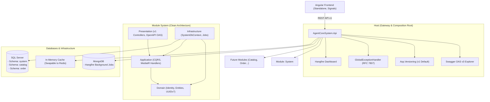

# Kiến trúc Tổng thể Hệ thống (Architecture Overview)

## 1. Mô hình Modular Monolith + Clean Architecture
Hệ thống được thiết kế theo mô hình **Modular Monolith**, kết hợp các ưu điểm của Monolith (dễ phát triển, triển khai đơn giản, transaction nhất quán) với ưu điểm của Microservices (tách biệt ranh giới nghiệp vụ, độc lập dữ liệu, sẵn sàng tách thành Microservices độc lập khi cần).

## 2. Luồng Xử lý một Request (CQRS + Problem Details)
1. **Client** gửi HTTP request (ví dụ: `POST /api/v1/users`).
2. **Host** định tuyến qua API Versioning v1 đến `UsersController`.
3. Controller đóng gói dữ liệu thành `CreateUserCommand` và gửi đến MediatR `ISender`.
4. **MediatR Pipeline** lần lượt chạy qua các Behavior:
   - `LoggingBehavior`: Log thời gian bắt đầu.
   - `ValidationBehavior`: Chạy FluentValidation. Nếu có lỗi, trả về `Result.Failure(Error.Validation(...))`.
   - `PerformanceBehavior`: Cảnh báo nếu handler chạy quá 500ms.
5. **Handler** tiếp nhận command, thực hiện nghiệp vụ thông qua Domain Entities và Repositories.
6. Handler trả về `Result<Guid>`.
7. **Controller** dùng `ToProblemDetails()` nếu có lỗi hoặc trả về `ApiResponse<Guid>` nếu thành công.
8. Nếu có lỗi ngoại lệ đột xuất, `GlobalExceptionHandler` bắt và sinh mã 500 RFC 7807 kèm `traceId`.

