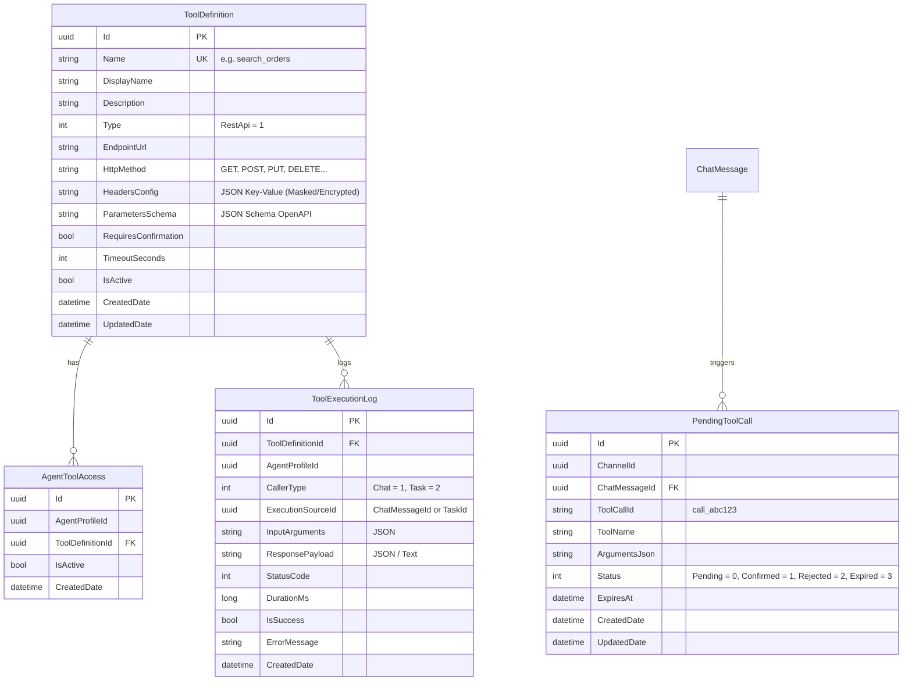
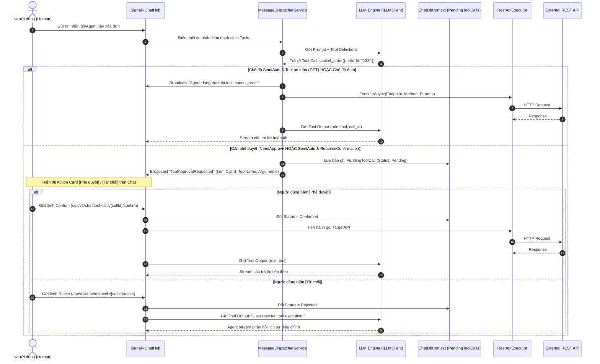

# Design Document: Sprint 3 - No-Code Tool Builder & LLM Function Calling Engine

- **Tác giả:** Phong Minh Đặng / Antigravity
- **Ngày tạo:** 21/11/2026
- **Trạng thái:** Bản hoàn thiện chờ phê duyệt (Final Draft for Approval)
- **Dự án:** AgentCoreSystem (.NET 9 Modular Monolith & Angular Standalone)
- **Tài liệu gốc tham chiếu:** [.agents/specs/2026-11-18-agent-core-system-design.md](file:///c:/Workplaces/PROJECT/AgentCoreSystem/.agents/specs/2026-11-18-agent-core-system-design.md)

---

## 1. Mục Đích & Bối Cảnh (Intent & The Why)

Sau khi hoàn thành:
- **Sprint 0:** Nền tảng Tổ chức & Quản lý Agent (`Module.Organization`, schema `org`).
- **Sprint 1:** Kênh Chat Thời Gian Thực & Bộ Lọc Kích Hoạt (`Module.Chat`, schema `chat`, SignalR, `@mention` router).
- **Sprint 2:** Bảng Kanban & Tác Vụ Chạy Ngầm (`Module.Tasks`, schema `task`, Hangfire, Review Gate).

Hiện tại các Agent trong hệ thống mới chỉ đóng vai trò là "Người đàm thoại" (Conversationalist) và "Người viết báo cáo" (Text Generator) dựa trên kiến thức tĩnh của Model LLM. Để tiến tới mô hình **Autonomous AI Workforce (Biệt đội Nhân sự AI Tự chủ)**, Agent bắt buộc phải có "bàn tay" để hành động:
1. **Khả năng tương tác với thế giới bên ngoài (Tool / Function Calling):** Tra cứu dữ liệu thời gian thực (thời tiết, tỷ giá, tin tức, dữ liệu nội bộ công ty) và thực hiện các hành động tự động hóa (gọi REST API, gửi thông báo, kích hoạt webhook).
2. **Hệ sinh thái No-Code Tool Builder:** Người quản trị / Founder có thể tự định nghĩa các Tool REST API ngay trên giao diện web (nhập Endpoint, Method, Headers, và JSON Schema tham số) mà không cần can thiệp hay viết thêm mã backend.
3. **Quản trị An toàn Thực thi (Human-in-the-Loop Governance):** Với các Tool có tính rủi ro (POST, PUT, DELETE, gửi email, cập nhật DB), hệ thống hỗ trợ cơ chế phê duyệt tương tác (`Need Approve`) để con người kiểm soát payload trước khi thực thi, bên cạnh chế độ tự động hoàn toàn (`Auto Mode`).

---

## 2. Mục Tiêu, Phi Mục Tiêu & Chống Mục Tiêu (Goals, Non-Goals & Anti-Goals)

### 2.1. Goals (Mục tiêu bắt buộc)
- **Backend Modular Monolith Architecture:**
  - Dựng mới phân hệ `Module.Agents` độc lập gồm 4 project (`Domain`, `Application`, `Infrastructure`, `Presentation`) trên schema SQL Server riêng `agent`, quản lý EF Migrations qua bảng `__EFMigrationsHistory_Agents`.
  - Thiết kế Entities schema `agent`:
    - `ToolDefinition`: `Id` (UUIDv7), `Name` (tên định danh, e.g. `check_weather`), `DisplayName`, `Description` (mô tả chức năng cho LLM), `Type` (enum `RestApi`), `EndpointUrl`, `HttpMethod`, `HeadersConfig` (JSON map headers, mã hóa secret), `ParametersSchema` (JSON Schema chuẩn OpenAPI/JSON Schema), `RequiresConfirmation` (bool), `TimeoutSeconds` (int), `IsActive` (bool).
    - `AgentToolAccess`: `Id` (UUIDv7), `AgentProfileId` (Guid), `ToolDefinitionId` (Guid), `IsActive` (bool).
    - `ToolExecutionLog`: `Id` (UUIDv7), `ToolDefinitionId` (Guid), `AgentProfileId` (Guid), `CallerType` (`Chat` | `Task`), `ExecutionSourceId` (ChatMessageId hoặc TaskId), `InputArguments` (nvarchar(max)), `ResponsePayload` (nvarchar(max)), `StatusCode` (int?), `DurationMs` (long), `IsSuccess` (bool), `ErrorMessage` (nvarchar(max)).
  - Bổ sung cấu hình chế độ thực thi trên `AgentProfile` (Module `Organization`):
    - `ToolExecutionMode`: Enum `Auto = 0`, `SemiAuto = 1` (Mặc định), `NeedApprove = 2`.
  - Bổ sung bảng `chat.PendingToolCalls` (Module `Chat`):
    - Lưu trữ lời gọi tool đang chờ người dùng phê duyệt trong kênh chat: `Id` (UUIDv7), `ChannelId`, `ChatMessageId`, `ToolCallId`, `ToolName`, `ArgumentsJson`, `Status` (enum `Pending`, `Confirmed`, `Rejected`, `Expired`), `ExpiresAt`.
- **Dịch vụ Thực Thi REST API Tool (`RestApiToolExecutor`):**
  - Đặt phần lõi HTTP Caller không trạng thái tại `Shared.Infrastructure.Http` với tên `IRestApiExecutor` / `RestApiExecutor`.
  - Thực thi HTTP call an toàn: Thay thế tham số path `/users/{id}`, gắn query params cho GET `?query=abc`, gắn JSON body cho POST/PUT/PATCH.
  - Tích hợp SSRF Guard: Chặn gọi các IP nội bộ nhạy cảm (`127.0.0.1`, `localhost`, `169.254.169.254`, subnet link-local/private LAN trừ khi được cấp phép).
  - Kiểm soát Timeout (mặc định 30s) và giới hạn kích thước response (tránh làm tràn LLM context).
- **Nâng Cấp LLM Engine (`Shared.Infrastructure.LLM`):**
  - Mở rộng `ILLMClient` và `OpenAiCompatibleClient` hỗ trợ chuẩn OpenAI Tools & Function Calling:
    - Truyền danh sách `tools` trong request payload.
    - Xử lý phản hồi `tool_calls` từ LLM.
    - Vòng lặp đàm thoại Tool Call Loop (Agent yêu cầu Tool $\rightarrow$ Thực thi $\rightarrow$ Nạp kết quả `role: tool` $\rightarrow$ Model sinh câu trả lời tiếp theo). Giới hạn tối đa 5 bước lặp (`MaxToolIterations = 5`) chống lặp vô tận.
- **Tích Hợp Luồng Phê Duyệt (Approval Flow) cho Chat & Tasks:**
  - **Kênh Chat (`SignalRChatHub` & `MessageDispatcherService`):**
    - Khi gặp Tool cần duyệt (`NeedApprove` hoặc `SemiAuto` + `RequiresConfirmation`): Hệ thống lưu bản ghi vào `chat.PendingToolCalls`, phát sự kiện `ToolApprovalRequested` qua SignalR tới Group kênh chat.
    - Người dùng xem Action Card trên giao diện Chat và bấm **[Phê duyệt & Chạy]** hoặc **[Từ chối]**.
    - API `/api/v1/chat/tool-calls/{callId}/confirm`: Thực thi tool, lưu kết quả tin nhắn role `tool`, kích hoạt lại LLM đàm thoại tiếp.
    - API `/api/v1/chat/tool-calls/{callId}/reject`: Nạp phản hồi *"User rejected tool execution"* vào context để LLM nhận diện và tiếp tục trả lời khéo léo.
  - **Tác vụ Nền Hangfire (`TaskAgentExecutionJob`):**
    - Chạy tự động các tool an toàn. Nếu gặp tool đòi hỏi phê duyệt trong môi trường background không tương tác, hệ thống ghi log cảnh báo vào `TaskActivityLog` và chuyển Task sang `InReview` để người dùng nghiệm thu.
- **Bảo Mật API Keys & Headers:**
  - Mã hóa token bí mật khi lưu trữ.
  - API `GET` trả về chuỗi ẩn dạng `••••••••` cho các header nhạy cảm (`Authorization`, `X-Api-Key`, `ApiKey`).
- **Frontend Angular 19+ Standalone:**
  - **Màn hình Quản Lý Tools (`/tools`):**
    - Bảng danh sách Tool: Tên, Phương thức HTTP, Endpoint, Cờ yêu cầu phê duyệt, Trạng thái.
    - Dialog/Form Tạo & Sửa Tool: Input Endpoint, Chọn Method, Quản lý Headers key-value, Trình biên tập JSON Schema có kiểm tra lỗi cú pháp (Syntax Validation).
    - Dialog Test Tool: Nhập arguments JSON mẫu, gửi lệnh test trực tiếp, xem kết quả HTTP Status và Response JSON.
  - **Màn hình Cấu Hình Agent Profile:**
    - Bổ sung nhóm cấu hình **Chế độ thực thi công cụ (Tool Execution Mode)**: Radio / Select với 3 lựa chọn trực quan (`Auto`, `SemiAuto`, `NeedApprove`) có mô tả giải thích.
    - Danh sách Checkbox chọn các Tool được cấp quyền cho Agent.
  - **Tương Tác Chat Realtime:**
    - Component hiển thị Tool Calling Status: Badge thông báo khi Agent đang gọi tool.
    - Card yêu cầu phê duyệt Tool Call (Interactive Approval Card) có 2 nút [Xác nhận] và [Từ chối].

### 2.2. Non-Goals (Không làm trong Sprint 3)
- Chưa triển khai Python venv sandbox execution (dành riêng cho Sprint 4).
- Chưa hỗ trợ OAuth2 3-legged authorization flow phức tạp cho tools (tập trung API Keys, Bearer Tokens, Custom Headers).
- Chưa hỗ trợ GraphQL Connector (chỉ tập trung vào RESTful API).

### 2.3. Anti-Goals (Tuyệt đối nghiêm cấm)
- **CẤM HARDCODE**: Không hardcode API URL, token hoặc tham số tool trong mã nguồn.
- **CẤM GỌI API KHÔNG KIỂM SOÁT (SSRF PROTECTION)**: Không cho phép Agent tự tiện gửi request đến các địa chỉ host metadata cloud nguy hiểm hoặc endpoint admin nội bộ chưa qua phê duyệt.
- **CẤM VÒNG LẶP TOOL VÔ TẬN**: Bắt buộc giới hạn `MaxToolIterations = 5` trong mỗi chu trình hội thoại; nếu vượt quá phải ngắt và thông báo lỗi.
- **CẤM BỎ QUA XÁC THỰC QUYỀN TRÊN CHAT CONFIRM**: Chỉ thành viên con người (`MemberType.Human`) trong Kênh mới có quyền bấm phê duyệt tool call.

---

## 3. Các Phương Án Kỹ Thuật Đã Cân Nhắc (Approaches)

### Phương án A: Cấu hình cấp Agent Profile thuần túy (Agent-level)
- Toàn bộ tool của Agent chỉ chạy theo 1 chế độ cố định: Auto hoặc NeedApprove.
- *Lý do loại bỏ:* Bất tiện khi tra cứu thông tin thường xuyên (GET) hoặc nguy hiểm khi chạy lệnh xóa (DELETE).

### Phương án B: Cấu hình cấp Tool Definition thuần túy (Tool-level)
- Từng tool quyết định việc có cần duyệt hay không thông qua cờ `RequiresConfirmation`.
- *Lý do loại bỏ:* Không phân quyền được theo cấp độ tín nhiệm của Agent (Junior vs Senior).

### Phương án C: Cơ chế Phân Cấp Lai (Hybrid Hierarchy - ĐƯỢC CHỌN ⭐️)
- **Cấp Tool:** Khai báo cờ `RequiresConfirmation: bool` (mặc định gợi ý `true` cho POST/PUT/DELETE/PATCH, `false` cho GET).
- **Cấp Agent:** Cung cấp 3 chế độ `ToolExecutionMode`:
  1. `Auto`: Tự trị 100% (thực thi mọi tool không cần hỏi).
  2. `NeedApprove`: Nghiêm ngặt 100% (bắt buộc phê duyệt mọi tool).
  3. `SemiAuto` (Khuyên dùng): Tự động thực thi tool an toàn (`RequiresConfirmation == false`), chỉ yêu cầu người dùng phê duyệt khi gặp tool có `RequiresConfirmation == true`.
- *Ưu điểm:* Cân bằng hoàn hảo giữa tính tự động hóa cao và sự an toàn tuyệt đối.

---

## 4. Đặc Tả Chi Tiết Kiến Trúc Triển Khai (The How)

### 4.1. Cấu Trúc Dữ Liệu Module Agents (Schema: `agent`) và Chat (Schema: `chat`)

### 4.2. Quản Trị Tool Calling & Vòng Lặp Phê Duyệt trong Chat

### 4.3. RestApiExecutor & Chuẩn Hóa Tham Số
- **URL Parameter Substitution:** Tự động phát hiện và thay thế các placeholder `{param_name}` trong `EndpointUrl` bằng giá trị trong JSON arguments.
- **Query String Binding:** Đối với request GET, các tham số không nằm trong path sẽ được serialize thành URL Query parameters (ví dụ: `?query=abc&limit=10`).
- **Request Body Binding:** Đối với request POST/PUT/PATCH, các tham số sẽ được serialize thành JSON Body gửi kèm header `Content-Type: application/json`.
- **SSRF Protection:** Kiểm tra IP trước khi kết nối (chặn loopback `127.0.0.1`, `::1`, link-local `169.254.x.x`, v.v.).

### 4.4. Hệ Thống API Endpoints (Module Agents & Module Chat)
Tuân thủ nghiêm ngặt chuẩn OAS v3, Result Pattern và RFC 7807 ProblemDetails:
- `GET /api/v1/agents/tools`: Danh sách toàn bộ Tool definitions (Headers nhạy cảm được mask `••••••••`).
- `GET /api/v1/agents/tools/{id}`: Chi tiết Tool definition.
- `POST /api/v1/agents/tools`: Tạo mới Tool definition.
- `PUT /api/v1/agents/tools/{id}`: Cập nhật Tool definition.
- `DELETE /api/v1/agents/tools/{id}`: Xóa mềm Tool definition.
- `POST /api/v1/agents/tools/{id}/test`: Chạy thử nghiệm Tool với payload giả lập.
- `GET /api/v1/agents/profiles/{agentId}/tools`: Lấy danh sách tool được phân quyền cho Agent.
- `PUT /api/v1/agents/profiles/{agentId}/tools`: Cập nhật phân quyền tool cho Agent.
- `POST /api/v1/chat/tool-calls/{callId}/confirm`: Phê duyệt thực thi cuộc gọi tool đang chờ trong chat.
- `POST /api/v1/chat/tool-calls/{callId}/reject`: Từ chối thực thi cuộc gọi tool đang chờ trong chat.

### 4.5. Thiết Kế Giao Diện Frontend Angular
- **Module Route `/tools` (`features/agents/tools`):**
  - `ToolListComponent`: Bảng quản lý các công cụ, lọc theo Method (GET, POST...), tìm kiếm theo tên, nút [Tạo Tool Mới].
  - `ToolEditorComponent`: Form cấu hình đầy đủ: Tên, Mô tả, Endpoint, Headers editor (Add/Remove row), JSON Schema Editor (với validator cú pháp), Checkbox `Yêu cầu phê duyệt trước khi chạy`.
  - `ToolTestDialogComponent`: Modal test nhanh: tự động sinh form hoặc textarea JSON để điền tham số, hiển thị response status, execution time và JSON viewer.
- **Cấu hình Agent Profile:**
  - Bổ sung nhóm cấu hình **Chế độ thực thi công cụ (Tool Execution Mode)**: Radio / Select với 3 lựa chọn trực quan (`Auto`, `SemiAuto`, `NeedApprove`) có mô tả giải thích.
  - Danh sách Checkbox chọn các Tool được cấp quyền cho Agent.
- **Trải nghiệm Chat Realtime:**
  - Component hiển thị Tool Calling Status: Badge thông báo khi Agent đang gọi tool.
  - Card yêu cầu phê duyệt Tool Call (Interactive Approval Card) có 2 nút [Xác nhận] và [Từ chối].

---

## 5. Kế Hoạch Triển Khai Chi Tiết (Phân Tách Giai Đoạn)

1. **Giai đoạn 1 (Backend Core - Module Agents & Persistence):**
   - Tạo 4 project Clean Architecture cho `Module.Agents` (`Domain`, `Application`, `Infrastructure`, `Presentation`).
   - Cấu hình `AgentsDbContext` trên schema `agent`, thêm EF Migration `__EFMigrationsHistory_Agents`.
   - Bổ sung enum `ToolExecutionMode` cho `AgentProfile` trong `Module.Organization`.
   - Bổ sung entity `PendingToolCall` và migration cho schema `chat`.
2. **Giai đoạn 2 (Tool Execution & LLM Function Calling Engine):**
   - Viết `RestApiExecutor` tại `Shared.Infrastructure.Http` kèm SSRF guard và unit tests.
   - Nâng cấp `ILLMClient` và `OpenAiCompatibleClient` hỗ trợ OpenAI Function Calling specs.
   - Mở rộng `MessageDispatcherService` trong `Module.Chat` và `TaskAgentExecutionJob` trong `Module.Tasks` để điều phối tool calling loop & pending approval state.
3. **Giai đoạn 3 (Backend API Endpoints):**
   - Triển khai đầy đủ các API CRUD, Test tool, Quản lý quyền Agent-Tool và Confirm/Reject tool calls.
4. **Giai đoạn 4 (Frontend Angular Standalone):**
   - Xây dựng giao diện Quản lý Tool (`/tools`), Dialog Test Tool.
   - Tích hợp cấu hình Tool vào màn hình Agent Profile.
   - Bổ sung UI Action Card phê duyệt Tool trong khung Chat và cập nhật SignalR Hub listeners.
5. **Giai đoạn 5 (Kiểm Thử Tích Hợp & Rà Soát Tiêu Chuẩn):**
   - Kiểm thử toàn diện kịch bản end-to-end: Tạo No-Code Tool $\rightarrow$ Gán cho Agent $\rightarrow$ Chat kích hoạt Tool $\rightarrow$ Duyệt/Chạy $\rightarrow$ Kiểm tra log và kết quả.
   - Rà soát toàn bộ quy chuẩn với `/review` (anti-ai-slop, csharp-conventions, angular-standards).
