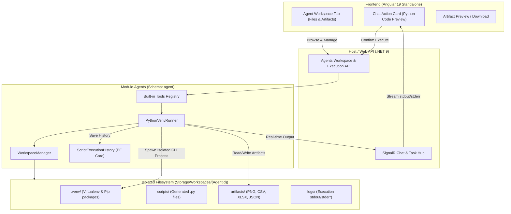

# Design Document: Sprint 4 - Agent Python Workspace & Isolated Environment (.venv Sandbox)

- **Tác giả:** Phong Minh Đặng / Antigravity
- **Ngày tạo:** 21/11/2026
- **Trạng thái:** Bản hoàn thiện chờ phê duyệt (Final Draft for Approval)
- **Dự án:** AgentCoreSystem (.NET 9 Modular Monolith & Angular Standalone)
- **Tài liệu gốc tham chiếu:** [.agents/specs/2026-11-18-agent-core-system-design.md](file:///c:/Workplaces/PROJECT/AgentCoreSystem/.agents/specs/2026-11-18-agent-core-system-design.md)

---

## 1. Mục Đích & Bối Cảnh (Intent & The Why)

Sau khi hoàn thành Sprint 3:
- Các Agent đã sở hữu **No-Code Tool Builder** và **Function Calling Engine** để giao tiếp với các hệ thống bên ngoài qua chuẩn REST API.
- Đã hoàn thiện cơ chế an toàn **SSRF Guard**, che giấu bí mật (**Secret Masking**), và 3 chế độ tự chủ tương tác (**Auto / Semi-Auto / Need Approve**).

Tuy nhiên, trong bài toán thực tế của một **Biệt đội Nhân sự AI Tự chủ (Autonomous AI Workforce)**:
1. **Xử lý Dữ liệu Ad-hoc & Phân tích Đa năng:** Agent thường xuyên phải đối mặt với các yêu cầu phân tích dữ liệu phức tạp (đọc file CSV/Excel lớn, thống kê mô tả, tính toán ma trận, lọc dữ liệu), vẽ biểu đồ trực quan (matplotlib, seaborn), cào và làm sạch dữ liệu web (BeautifulSoup), hoặc parse các định dạng tài liệu đặc thù. REST API không thể đáp ứng được các tác vụ tính toán tùy biến này.
2. **Không gian Làm việc & Môi trường Cách ly (.venv Sandbox):** Mỗi Agent cần một không gian làm việc chuyên biệt trên ổ đĩa (`Storage/Workspaces/{AgentId}/`) và một môi trường Python ảo (`.venv`) riêng biệt. Agent có toàn quyền tự sinh mã Python, cài đặt thư viện phụ thuộc (`pip install <package>`), và thực thi script mà không gây ô nhiễm môi trường máy chủ hay xung đột thư viện giữa các Agent.
3. **Quản lý Sản phẩm Đầu ra (Artifacts):** Các kết quả do Agent tạo ra (file báo cáo `.md`, biểu đồ `.png`, dữ liệu trích xuất `.csv`, `.xlsx`, file kết quả `.json`) phải được phân loại thành **Artifacts**, liên kết chặt chẽ với Kênh Chat hoặc Bảng Kanban để người dùng có thể xem trước (Preview) hoặc tải về (Download) nhanh chóng.

---

## 2. Mục Tiêu, Phi Mục Tiêu & Chống Mục Tiêu (Goals, Non-Goals & Anti-Goals)

### 2.1. Goals (Mục tiêu bắt buộc)

- **Backend Architecture & Storage Isolation:**
  - Thiết lập hạ tầng lưu trữ vật lý: Cấu hình `Storage:WorkspacesRootPath` (mặc định trỏ về `Storage/Workspaces/` tại thư mục chạy).
  - Cấu trúc thư mục chuẩn của mỗi Agent:
    ```text
    Storage/Workspaces/{AgentId}/
    ├── .venv/                   # Môi trường ảo Python độc lập
    ├── scripts/                 # Các file script .py được sinh ra
    ├── artifacts/               # Sản phẩm đầu ra (PNG, CSV, XLSX, JSON, TXT)
    └── logs/                    # Log chi tiết các lần chạy (stdout, stderr)
    ```
  - Quản trị Workspace (`IWorkspaceManager` / `WorkspaceManager`): Tạo mới, kiểm tra dung lượng, xóa dọn dẹp, và duyệt cây thư mục trong workspace của Agent.
- **Python Execution Engine (`IPythonSandboxRunner` / `PythonVenvRunner`):**
  - **Khởi tạo `.venv` tự động:** Thực hiện `python -m venv .venv` khi Agent lần đầu được kích hoạt tính năng Sandbox hoặc khi người dùng yêu cầu trên giao diện.
  - **Quản lý dependencies:** Cài đặt package qua `pip install <packages>` cô lập trong `.venv` của Agent, đọc danh sách package đã cài (`pip list`).
  - **Thực thi script an toàn (Safe Execution):**
    - Chạy script qua `ProcessStartInfo` trỏ chính xác vào Python binary của `.venv` (`.venv/Scripts/python.exe` trên Windows hoặc `.venv/bin/python` trên Linux/macOS).
    - **Timeout Enforcement:** Buộc ngắt (Kill Process Tree) khi vượt quá thời gian cho phép (mặc định 60 giây, tối đa 300 giây).
    - **Environment Variable Stripping:** Làm sạch 100% các biến môi trường nhạy cảm của backend (loại bỏ toàn bộ ConnectionStrings, JWT Secret, LLM API Keys). Chỉ truyền các biến môi trường thiết yếu của hệ thống điều hành (`SYSTEMROOT`, `PATH`, `TMP`, `TEMP`).
    - **Path Traversal Guard:** Ngăn chặn script truy cập hay sửa đổi các file nằm ngoài thư mục `Storage/Workspaces/{AgentId}/`.
- **Entities & Schema Database (schema `agent`):**
  - `AgentWorkspaceConfig`: Lưu cấu hình sandbox của Agent (`Id`, `AgentProfileId`, `PythonVersion`, `MaxTimeoutSeconds`, `IsVenvReady`, `IsActive`, `LastActiveAt`, `StorageUsedBytes`).
  - `ScriptExecutionHistory`: Lưu lịch sử chạy code (`Id`, `AgentProfileId`, `CallerType` [`Chat`|`Task`], `ExecutionSourceId`, `ScriptName`, `ScriptContent`, `ExitCode`, `Stdout`, `Stderr`, `DurationMs`, `IsTimeout`, `ArtifactsJson`, `CreatedAt`).
- **Tích hợp LLM Function Calling Engine (Mở rộng Sprint 3):**
  - Đăng ký bộ **System Built-in Python Tools**:
    1. `execute_python_code(code: string, script_name?: string, timeout_seconds?: number)`: Chạy đoạn code Python, ghi nhận stdout/stderr và bóc tách các file artifact mới sinh trong thư mục `artifacts/`.
    2. `install_python_packages(packages: string[])`: Chạy `pip install` để bổ sung thư viện cho Agent.
    3. `list_workspace_files(category?: "scripts" | "artifacts" | "all")`: Liệt kê các file hiện có trong workspace.
  - Tương thích 3 chế độ tự chủ (`Auto`, `SemiAuto`, `NeedApprove`):
    - Khi Agent gọi `execute_python_code` ở chế độ `NeedApprove` hoặc `SemiAuto`, Action Card trong Chat hiển thị khối code syntax-highlighted kèm danh sách package yêu cầu để người dùng đọc trước khi bấm **[Phê duyệt & Chạy]**.
- **Tích hợp Hangfire Background Tasks (Sprint 2):**
  - Khi Agent xử lý Task trên Kanban đòi hỏi tính toán/cào dữ liệu, Hangfire gọi `IPythonSandboxRunner`, tự động chuyển các file sinh ra trong `artifacts/` thành bản ghi `TaskArtifact` (bảng `task.TaskArtifacts`) và đính kèm vào Task Item.
- **Frontend Angular 19+ Standalone:**
  - **Tab Workspace trong Hồ Sơ Agent (`/agents/:id`):**
    - Trạng thái `.venv` (Đã sẵn sàng / Chưa khởi tạo / Đang khởi tạo). Nút "Khởi tạo / Tái tạo .venv", xem danh sách thư viện `pip list`.
    - File Browser: Cây thư mục `scripts/` và `artifacts/`, kích thước từng file, ngày tạo.
    - Modal Xem Trước (Artifact Viewer): Xem trước hình ảnh biểu đồ (`.png`, `.jpg`), xem bảng dữ liệu (`.csv`, `.json`), xem mã nguồn `.py` với Monaco/Prism hoặc syntax highlighter đơn giản, nút Tải file về máy.
  - **Cải tiến Chat Action Card:**
    - Render khối code Python chuyên biệt trong Action Card (nền tối, số dòng code, nút copy code).
    - Hiển thị kết quả stdout/stderr ngay trên chat sau khi chạy thành công.

### 2.2. Non-Goals (Không thuộc phạm vi Sprint 4)

- Không triển khai container orchestration phức tạp như Docker Swarm hay Kubernetes (giữ đúng Phương án 1: Native Process Runner với `.venv` để duy trì tính chất self-hosted gọn nhẹ, không đòi hỏi Docker).
- Không hỗ trợ hiển thị giao diện đồ họa tương tác (GUI desktop như Tkinter/PyQt). Mọi kết quả trực quan phải được xuất ra file ảnh (PNG/SVG) hoặc file HTML tĩnh.
- Không cấu hình GPU passthrough (CUDA) phục vụ huấn luyện Deep Learning nặng; chỉ tập trung vào CPU execution cho tác vụ văn phòng, phân tích dữ liệu, tự động hóa.

### 2.3. Anti-Goals (Tuyệt đối nghiêm cấm)

- **CẤM** nhúng engine Python trực tiếp vào in-process của .NET (như Python.NET hoặc IronPython chạy trong cùng bộ nhớ Web API). Nếu Python script bị crash bộ nhớ, tràn stack, hoặc segfault, toàn bộ Web API host sẽ chết theo. Bắt buộc phải chạy **Out-of-Process** qua CLI.
- **CẤM** truyền nguyên vẹn `Environment.GetEnvironmentVariables()` của backend vào process Python. Script người dùng hoặc LLM sinh ra có thể gọi `os.environ` để lấy cắp chuỗi kết nối Database và JWT Secret.
- **CẤM** cho phép đường dẫn tương đối hoặc path traversal (`../../`) trỏ ra ngoài thư mục `Storage/Workspaces/{AgentId}/`.

---

## 3. Kiến Trúc Kỹ Thuật Chi Tiết (Technical Architecture)



### 3.1. Thiết Kế Cơ Sở Dữ Liệu (Schema `agent`)

#### Bảng `agent.AgentWorkspaceConfigs`
Lưu trữ cấu hình môi trường của từng Agent:
```sql
CREATE TABLE [agent].[AgentWorkspaceConfigs] (
    [Id] UNIQUEIDENTIFIER NOT NULL,
    [AgentProfileId] UNIQUEIDENTIFIER NOT NULL,
    [PythonVersion] NVARCHAR(64) NULL,
    [MaxTimeoutSeconds] INT NOT NULL DEFAULT 60,
    [IsVenvReady] BIT NOT NULL DEFAULT 0,
    [IsActive] BIT NOT NULL DEFAULT 1,
    [StorageUsedBytes] BIGINT NOT NULL DEFAULT 0,
    [LastActiveAt] DATETIME2 NULL,
    [CreatedDate] DATETIME2 NOT NULL,
    [UpdatedDate] DATETIME2 NULL,
    [IsDeleted] BIT NOT NULL DEFAULT 0,
    CONSTRAINT [PK_AgentWorkspaceConfigs] PRIMARY KEY CLUSTERED ([Id]),
    CONSTRAINT [UQ_AgentWorkspaceConfigs_AgentProfileId] UNIQUE ([AgentProfileId])
);
```

#### Bảng `agent.ScriptExecutionHistories`
Lưu trữ nhật ký thực thi mã nguồn phục vụ audit và tracing:
```sql
CREATE TABLE [agent].[ScriptExecutionHistories] (
    [Id] UNIQUEIDENTIFIER NOT NULL,
    [AgentProfileId] UNIQUEIDENTIFIER NOT NULL,
    [CallerType] NVARCHAR(32) NOT NULL, -- 'Chat', 'Task'
    [ExecutionSourceId] UNIQUEIDENTIFIER NOT NULL, -- ChatMessageId hoặc TaskId
    [ScriptName] NVARCHAR(256) NOT NULL,
    [ScriptContent] NVARCHAR(MAX) NOT NULL,
    [ExitCode] INT NOT NULL,
    [Stdout] NVARCHAR(MAX) NULL,
    [Stderr] NVARCHAR(MAX) NULL,
    [DurationMs] BIGINT NOT NULL,
    [IsTimeout] BIT NOT NULL DEFAULT 0,
    [ArtifactsJson] NVARCHAR(MAX) NULL, -- Danh sách file mới sinh: [{"fileName":"chart.png","sizeBytes":45120,"relativePath":"artifacts/chart.png"}]
    [CreatedDate] DATETIME2 NOT NULL,
    [UpdatedDate] DATETIME2 NULL,
    [IsDeleted] BIT NOT NULL DEFAULT 0,
    CONSTRAINT [PK_ScriptExecutionHistories] PRIMARY KEY CLUSTERED ([Id])
);
CREATE INDEX [IX_ScriptExecutionHistories_AgentProfileId] ON [agent].[ScriptExecutionHistories] ([AgentProfileId]);
CREATE INDEX [IX_ScriptExecutionHistories_ExecutionSourceId] ON [agent].[ScriptExecutionHistories] ([ExecutionSourceId]);
```

---

### 3.2. Thiết Kế Dịch Vụ Cốt Lõi (Core Services)

#### 1. `IWorkspaceManager`
Quản lý cây thư mục và đường dẫn vật lý:
```csharp
namespace AgentCoreSystem.Module.Agents.Application.Services;

public interface IWorkspaceManager
{
    string GetAgentWorkspacePath(Guid agentProfileId);
    string GetVenvPath(Guid agentProfileId);
    string GetPythonExecutablePath(Guid agentProfileId);
    string GetScriptsPath(Guid agentProfileId);
    string GetArtifactsPath(Guid agentProfileId);
    string GetLogsPath(Guid agentProfileId);
    
    Task<Result> EnsureWorkspaceDirectoriesAsync(Guid agentProfileId, CancellationToken ct = default);
    Task<Result<WorkspaceStatsDto>> GetWorkspaceStatsAsync(Guid agentProfileId, CancellationToken ct = default);
    Task<Result<IReadOnlyList<WorkspaceFileDto>>> ListFilesAsync(Guid agentProfileId, string? subFolder = null, CancellationToken ct = default);
    Task<Result<Stream>> GetFileStreamAsync(Guid agentProfileId, string relativeFilePath, CancellationToken ct = default);
    Task<Result> DeleteFileAsync(Guid agentProfileId, string relativeFilePath, CancellationToken ct = default);
}
```

#### 2. `IPythonSandboxRunner`
Thực thi CLI và bảo đảm an toàn tiến trình:
```csharp
namespace AgentCoreSystem.Module.Agents.Application.Services;

public record PythonExecutionRequest(
    Guid AgentProfileId,
    string ScriptContent,
    string? ScriptName = null,
    int? TimeoutSeconds = null,
    IReadOnlyDictionary<string, string>? ScriptArguments = null
);

public record PythonExecutionResult(
    bool IsSuccess,
    int ExitCode,
    string Stdout,
    string Stderr,
    long DurationMs,
    bool IsTimeout,
    IReadOnlyList<ArtifactFileDto> GeneratedArtifacts,
    string? ErrorMessage = null
);

public interface IPythonSandboxRunner
{
    Task<Result<string>> EnsureVenvInitializedAsync(Guid agentProfileId, CancellationToken ct = default);
    Task<Result<string>> InstallPackagesAsync(Guid agentProfileId, IEnumerable<string> packages, CancellationToken ct = default);
    Task<Result<IReadOnlyList<string>>> ListInstalledPackagesAsync(Guid agentProfileId, CancellationToken ct = default);
    Task<Result<PythonExecutionResult>> ExecuteScriptAsync(PythonExecutionRequest request, CancellationToken ct = default);
}
```

---

### 3.3. Cơ Chế Bảo Mật & Sandbox Guard

1. **Clean Environment Variables (Triệt tiêu rò rỉ bí mật):**
   Khi khởi tạo tiến trình `ProcessStartInfo`, hệ thống xóa toàn bộ biến môi trường mặc định (`info.Environment.Clear()`) và chỉ bổ sung danh sách biến whitelist an toàn:
   * `SYSTEMROOT`, `SYSTEMDRIVE`, `HOMEDRIVE`, `HOMEPATH` (Windows)
   * `PATH`: Trỏ ưu tiên vào thư mục `.venv/Scripts` (hoặc `.venv/bin`) của Agent, sau đó tới các thư mục hệ thống cơ bản (`C:\Windows\System32`).
   * `PYTHONUNBUFFERED = "1"` (để stdout/stderr được flush ngay lập tức).
   * `VIRTUAL_ENV`: Trỏ tới thư mục `.venv` của Agent.
2. **Process Tree Termination (Chống Treo CPU / Vô hạn Loop):**
   Sử dụng `process.Kill(entireProcessTree: true)` khi token timeout hoặc cancellation được kích hoạt.
3. **Chống Path Traversal:**
   Mọi đường dẫn file trước khi thao tác đọc/ghi đều đi qua phương thức kiểm tra canonical path:
   ```csharp
   var fullPath = Path.GetFullPath(Path.Combine(workspacePath, userPath));
   if (!fullPath.StartsWith(workspacePath, StringComparison.OrdinalIgnoreCase))
   {
       return Result.Failure(Error.Validation("Path.Invalid", "Access outside agent workspace is prohibited."));
   }
   ```
4. **Snapshot Artifact Detection:**
   Trước khi chạy script, `PythonVenvRunner` lấy danh sách file hiện có trong `artifacts/`. Sau khi script chạy xong, hệ thống so sánh để tìm ra chính xác những file mới được sinh ra trong phiên chạy đó và đóng gói thành kết quả trả về cho LLM.

---

### 3.4. Tích Hợp System Tools Vào LLM Function Calling

Trong `Module.Agents`, hệ thống tự động đăng ký các Tools mang loại `SystemBuiltIn`:
1. `execute_python_code`:
   - Mô tả cho LLM: *"Execute Python code inside your isolated virtual environment sandbox. Use this to calculate complex numbers, parse files, generate data charts, or run algorithms. Files saved in 'artifacts/' directory will be preserved and delivered to the user."*
   - Parameters Schema:
     ```json
     {
       "type": "object",
       "properties": {
         "code": { "type": "string", "description": "The complete, executable Python code script" },
         "script_name": { "type": "string", "description": "Optional name of the script file, e.g. analyze_sales.py" },
         "timeout_seconds": { "type": "integer", "description": "Optional execution timeout in seconds (default 60, max 300)" }
       },
       "required": ["code"]
     }
     ```
2. `install_python_packages`:
   - Mô tả cho LLM: *"Install required Python libraries using pip into your isolated virtual environment."*
   - Parameters Schema:
     ```json
     {
       "type": "object",
       "properties": {
         "packages": { 
           "type": "array", 
           "items": { "type": "string" },
           "description": "List of package names to install, e.g. ['pandas', 'matplotlib', 'requests']" 
         }
       },
       "required": ["packages"]
     }
     ```

---

### 3.5. Danh Sách Web API Endpoints

| Method | Endpoint | Quyền | Mô tả |
| :--- | :--- | :--- | :--- |
| `GET` | `/api/v1/agents/{id}/workspace` | `Employee+` | Lấy thông tin cấu hình workspace & thống kê dung lượng |
| `POST` | `/api/v1/agents/{id}/workspace/init-venv` | `Admin+` | Kích hoạt khởi tạo hoặc sửa chữa `.venv` |
| `GET` | `/api/v1/agents/{id}/workspace/packages` | `Employee+` | Lấy danh sách package đã cài đặt (`pip list`) |
| `POST` | `/api/v1/agents/{id}/workspace/install-packages`| `Admin+` | Cài đặt package mới qua pip |
| `GET` | `/api/v1/agents/{id}/workspace/files` | `Employee+` | Duyệt danh sách file trong workspace (`scripts`, `artifacts`) |
| `GET` | `/api/v1/agents/{id}/workspace/files/download` | `Employee+` | Tải xuống một file cụ thể từ workspace |
| `POST` | `/api/v1/agents/{id}/workspace/execute` | `Employee+` | Endpoint test chạy script trực tiếp từ giao diện Admin |
| `GET` | `/api/v1/agents/{id}/workspace/history` | `Employee+` | Lấy lịch sử các lần chạy script của Agent |

---

### 3.6. Giao Diện Người Dùng (Angular 19 Standalone)

1. **Tab "Workspace & Artifacts" trong Hồ Sơ Agent (`/agents/:id`):**
   - Header hiển thị thẻ trạng thái: Python Version, Dung lượng ổ đĩa, Trạng thái `.venv` (Xanh: Sẵn sàng, Vàng: Chưa tạo, Đỏ: Lỗi).
   - Card bên trái: **File Explorer** phân tab `Artifacts` và `Scripts`. Mỗi hàng hiển thị tên file, icon loại file, dung lượng, thời gian cập nhật, nút tải về và nút xem trước.
   - Card bên phải: **Interactive Script Runner & Tester** cho phép quản trị viên nhập code Python mẫu, bấm chạy thử nghiệm và xem trực tiếp output stdout/stderr.
2. **Modal Xem Trước Artifact (Artifact Preview Modal):**
   - File ảnh (`.png`, `.jpg`, `.svg`): Hiển thị ảnh sắc nét, hỗ trợ phóng to và nút Download.
   - File bảng dữ liệu (`.csv`, `.json`): Render bảng dữ liệu phân trang trực quan.
   - File văn bản / code (`.txt`, `.py`, `.md`): Hiển thị code viewer với thanh scroll và nút sao chép.
3. **Nâng Cấp Chat Action Card Cho Python Execution:**
   - Khi Agent yêu cầu chạy code ở chế độ `NeedApprove`, Action Card sẽ hiển thị:
     - Tiêu đề: *Yêu cầu thực thi Python Script*
     - Khung xem mã nguồn với nền đen tối ưu, đánh số dòng và highlight cú pháp.
     - Nút **[Phê duyệt & Chạy]** và **[Từ chối]**.
     - Khi chạy xong, kết quả stdout và các file artifact sinh ra hiển thị dạng đính kèm (pills) ngay trong tin nhắn.

---

## 4. Kế Hoạch Kiểm Thử (Testing Strategy)

1. **Unit Testing (.NET 9 - xUnit, FluentAssertions, Moq):**
   - `WorkspaceManagerTests`: Kiểm tra tạo thư mục, bảo vệ chống Path Traversal (`../`), tính toán dung lượng.
   - `PythonVenvRunnerTests`: Kiểm tra command string, cơ chế stripping biến môi trường, xử lý khi script chạy thành công hoặc trả mã lỗi, phát hiện timeout và terminate process tree.
   - `ArtifactDetectionTests`: Kiểm tra so sánh snapshot file trước/sau khi chạy để phát hiện đúng các artifact mới tạo.
2. **Integration Testing:**
   - Kiểm tra khởi tạo `.venv` thực tế trên môi trường máy test.
   - Thực thi một script python cơ bản tính toán số nguyên và kiểm tra stdout trả về chính xác.
   - Chạy script tạo một file ảnh PNG hoặc CSV trong thư mục `artifacts/` và kiểm tra file tồn tại trên ổ đĩa.
3. **End-to-End Testing (Playwright):**
   - `sprint-4-python-workspace.spec.ts`:
     - Test 1: Mở trang cấu hình Agent, chuyển sang tab Workspace, kiểm tra hiển thị trạng thái `.venv`.
     - Test 2: Vào phòng chat, nhắn tin yêu cầu Agent chạy code tính toán hoặc sinh bảng dữ liệu.
     - Test 3: Xác minh Action Card xuất hiện với khối code Python, bấm xác nhận duyệt chạy.
     - Test 4: Kiểm tra kết quả phản hồi trên Chat kèm pill artifact đính kèm, bấm mở modal preview artifact thành công.

---

## 5. Tiêu Chí Nghiệm Thu (Acceptance Criteria & Definition of Done)

- [ ] Toàn bộ code C# tuân thủ triệt để quy tắc: Block-scoped namespaces, Primary Constructors, Result Pattern, ProblemDetails.
- [ ] Mọi entity kế thừa `BaseEntity<Guid>`, sinh khóa tự động bằng `Guid.CreateVersion7()`.
- [ ] Độc lập dữ liệu: Migration schema `agent` chạy mượt mà, lưu vào `__EFMigrationsHistory_Agents`.
- [ ] Bảo mật tuyệt đối: Không để lọt bất kỳ biến môi trường nào của backend vào process Python; chặn hoàn toàn path traversal ra ngoài workspace.
- [ ] Process Runner cắt tiến trình dứt khoát khi quá `TimeoutSeconds`, không để lại tiến trình ma (zombie process).
- [ ] Giao diện Angular 19 mượt mà, OnPush, Signal-based, đạt chuẩn thiết kế Minimalist / Hallmark.
- [ ] Bộ test E2E Playwright và Unit test chạy xanh 100%.
- [ ] `justfile` và tài liệu hướng dẫn được cập nhật đồng bộ.